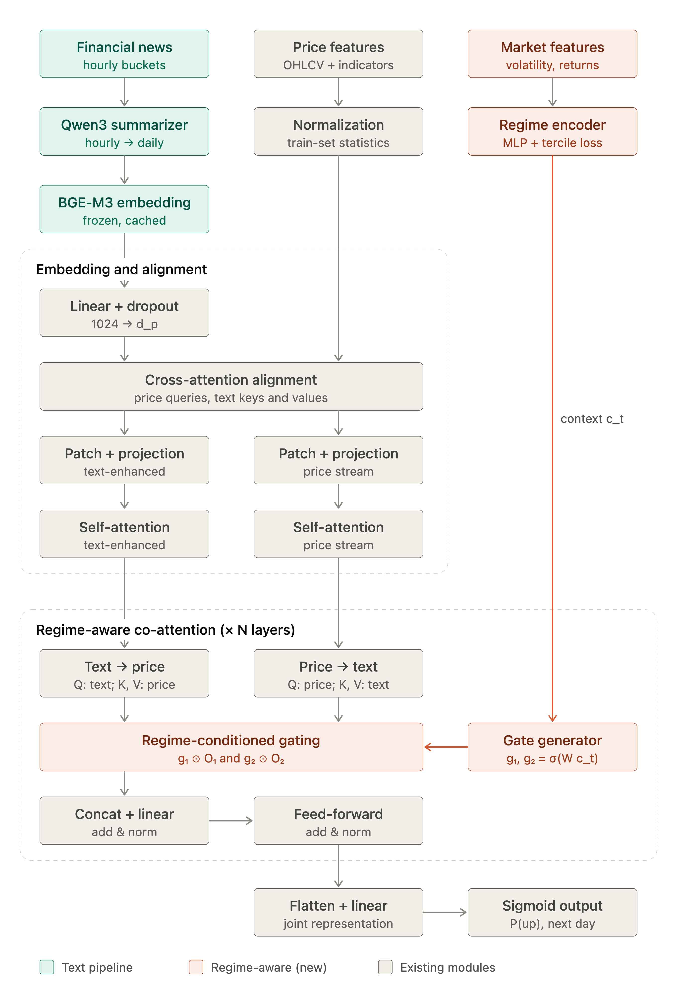

# Regime-Aware Text–Price Co-Attention

Regime-Aware Text–Price Co-Attention stock-trend prediction model.


The model combines historical market data with daily financial-news
representations to predict the next-day market movement. It is designed for
the [CMIN dataset](https://github.com/BigRoddy/CMIN-Dataset), but the
architecture is not limited to one stock universe.

## Updated architecture


```text
Historical price features ──┬──> Price patch Transformer ────────┐
                             │                                    │
                             └──> Market Regime Encoder ──> gate │
                                                                  │
News ─> Qwen3-8B summaries ─> BGE-M3 embeddings ─> Text encoder ─┤
                                                                  │
                         Regime-aware bidirectional co-attention ─┘
                                             │
                                  Classifier / next-day probability
```

The text-processing models are frozen during classifier training. The
price encoder, market-regime encoder, co-attention fusion layers, and
classifier are trainable.

## Main model components

### 1. Price feature encoder

The model receives a rolling window of historical price features. Each price
feature is treated as a separate channel and divided into overlapping
patches. A patch-based Transformer learns temporal patterns such as momentum,
trend, and short-term changes.

### 2. Qwen3-8B market-news summarizer

The original mT5-XLSum summarizer has been replaced with **Qwen3-8B**.

Qwen3 processes the available financial news in a hierarchical sequence:

1. News items are grouped into hourly documents.
2. Hourly documents are summarized.
3. The hourly summaries are combined into a daily summary.

The daily summary is produced once during cache construction rather than
inside every training step. Qwen3 is used in non-thinking/instruction mode,
and the generated summaries are kept frozen during downstream training.

### 3. BGE-M3 embedding model

The original mT5 encoder embeddings have been replaced with dense
**BGE-M3** embeddings (`BAAI/bge-m3`).

BGE-M3 converts each daily Qwen3 summary into a 1,024-dimensional vector.
The vector is normalized and then projected to the price representation width
before text–price interaction. This projection allows the downstream model to
remain independent of the embedding dimensionality.

### 4. Text and price encoders

The price sequence and the daily text embeddings are encoded separately:

- The **price encoder** learns temporal structure from patchified market
  features.
- The **text encoder** learns a compatible representation for the daily
  news context.
- A price-to-text alignment layer projects text features to the price feature
  width before cross-modal encoding.

## Updated co-attention fusion

The original fusion block used fixed bidirectional co-attention. The updated
fusion is market-regime aware and contains two additions.

### 1. Market Regime Encoder

The **Market Regime Encoder** learns the current market condition from
historical price features. It represents the market context using three
regime states:

- **Low volatility**
- **Medium volatility**
- **High volatility**

The encoder uses the historical price window to produce a continuous regime
representation and regime probabilities. This context is supplied to every
co-attention fusion block.

The regime representation helps the model distinguish, for example, between
a news signal occurring during a stable market and the same signal occurring
during a highly volatile market.

### 2. Dynamic Gating Mechanism

The co-attention block still computes both interaction directions:

- **Text-to-price attention:** text queries the price representation.
- **Price-to-text attention:** price queries the text representation.

The difference is that their contribution is no longer combined with a fixed
fusion rule. A regime-conditioned gating network uses the market context to
calculate adaptive weights for the two streams:

```text
market regime context
          │
          v
dynamic gate ──> text-to-price contribution
             └─> price-to-text contribution
```

In low-volatility conditions, the gate can emphasize stable cross-modal
relationships. In high-volatility conditions, it can increase or reduce the
contribution of either attention direction depending on the learned market
context. The gate is learned jointly with the rest of the trainable model.

The gated streams are concatenated or combined, passed through the fusion
projection, and then processed by residual connections, layer normalization,
and a feed-forward network.

## End-to-end data flow

For each stock and trading-day window:

1. Historical price features are normalized using the training split.
2. The price window is processed by the patch Transformer.
3. Historical prices are also passed to the Market Regime Encoder.
4. News is summarized hierarchically with frozen Qwen3-8B.
5. Daily summaries are converted to normalized BGE-M3 embeddings.
6. Text embeddings are projected to the price representation width.
7. Price-to-text and text-to-price attention are computed.
8. The regime-conditioned gate dynamically weights both attention streams.
9. The fused representation is passed through the classifier.
10. The output is a next-day upward-movement logit or probability.

## What changed from the original model

| Area | Original pipeline | Updated pipeline |
| --- | --- | --- |
| News summarizer | mT5-XLSum | Qwen3-8B |
| Daily text embedding | mT5 encoder, 768 dimensions | BGE-M3, 1,024 dimensions |
| Text embedding handoff | mT5-sized input | Dimension inferred from the cache and projected to price width |
| Co-attention fusion | Fixed bidirectional fusion | Market-regime-conditioned dynamic fusion |
| Market context | Not explicitly modeled | Low-, medium-, and high-volatility regime representation |
| Attention contribution | Static | Dynamically regulated by the market regime |
| Frozen components | mT5 summarizer and encoder | Qwen3 summarizer and BGE-M3 embedder |

The change in text models does not alter the downstream classifier interface:
the text representation is projected before co-attention, so the model can
consume either the original or updated cache format when the corresponding
configuration is selected.

## Key implementation areas

| Path | Responsibility |
| --- | --- |
| `config.py` | Model hyperparameters and Qwen3/BGE-M3 backend selection |
| `src/text_backends/qwen_backend.py` | Frozen Qwen3 summarization |
| `src/text_backends/bge_backend.py` | Frozen BGE-M3 dense embeddings |
| `src/text_backends/factory.py` | Text-backend construction and embedding dimensions |
| `scripts/build_text_cache.py` | Resumable summary and embedding-cache creation |
| `src/model.py` | Price encoder, text alignment, co-attention, and classifier |
| `src/data.py` | Price/text window loading and cache-dimension inference |

## Results

On the evaluated stock-trend prediction task, the updated model achieved:

| Metric | Score |
| --- | ---: |
| Accuracy (ACC) | **65.3%** |
| Matthews Correlation Coefficient (MCC) | **0.319** |

## Design principles

- Keep large language models outside the training loop.
- Keep summarization and embedding caches reproducible and inspectable.
- Let the price representation provide explicit market-regime context.
- Adapt cross-modal fusion to the current market condition.
- Preserve a dimension-independent interface between text embeddings and the
  trainable price model.
